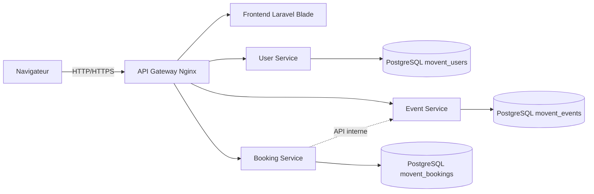
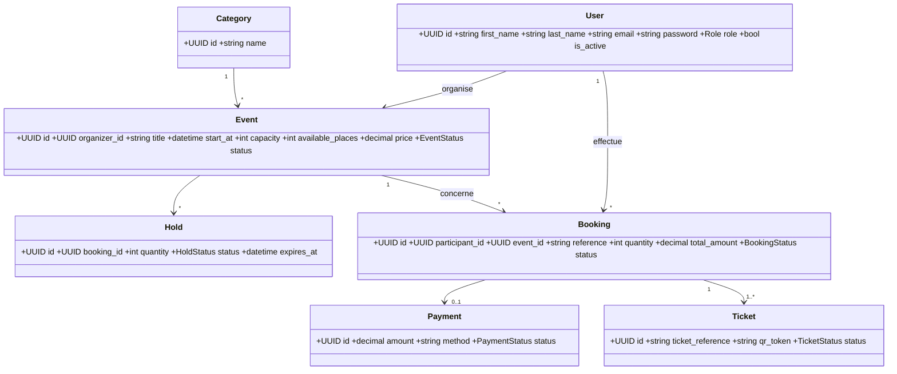
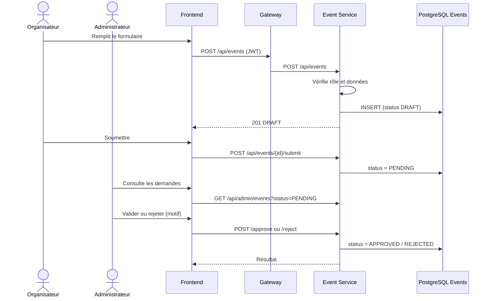
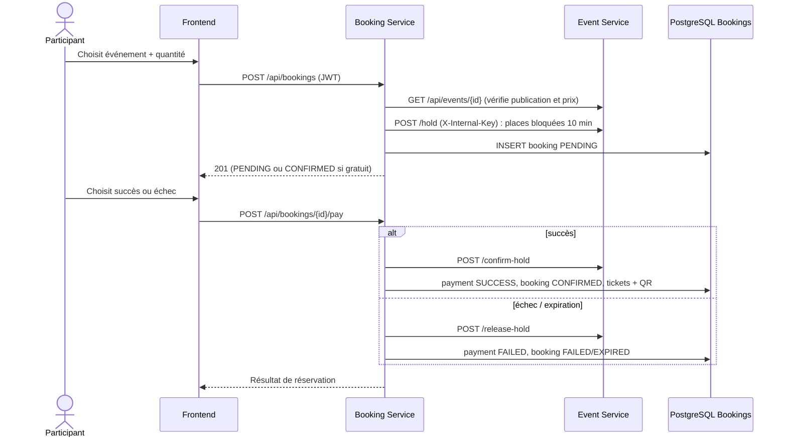
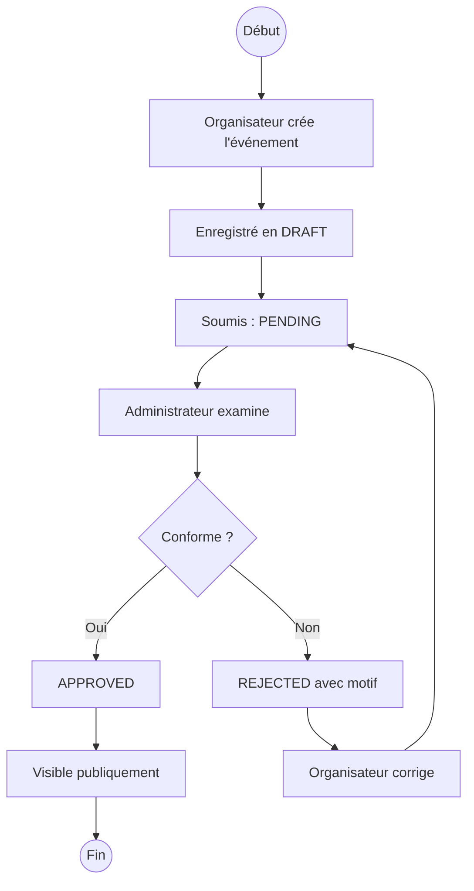
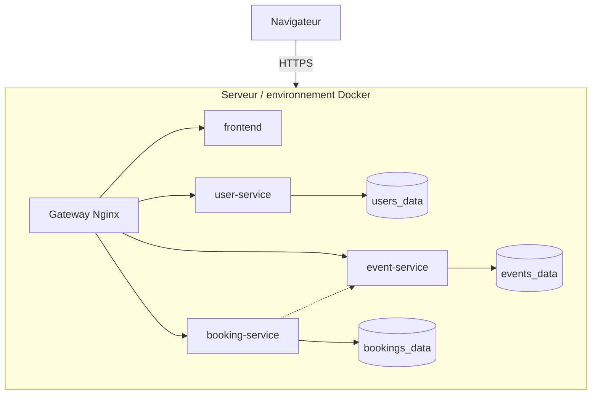

# MOVENT — Discover. Book. Experience.

Plateforme web de découverte, gestion et réservation d'événements, construite en **architecture microservices** avec **Laravel 11**, **PostgreSQL 16** et **Docker Compose**.

> Projet individuel — du 10 au 15 novembre 2026. Plateforme en ligne : **_à compléter (URL de l'hébergeur)_** · Dépôt : **_à compléter (lien GitHub)_**

## 1. Présentation et contexte

**Besoin.** Les organisateurs d'événements manquent d'un outil simple pour publier, faire valider et vendre leurs places ; les participants n'ont pas de point d'entrée unique pour découvrir et réserver.
**Solution.** MOVENT est une **infrastructure numérique nationale destinée à intégrer le patrimoine numérique de l'État togolais** — sous réserve de sa formalisation juridique et institutionnelle. Elle centralise et digitalise la gestion des événements sur l'ensemble du territoire : événements **publics** (ministères, institutions, administrations, collectivités, cérémonies officielles) comme **privés** (entreprises, associations, agences événementielles, organisateurs indépendants). Quatre profils : participants, organisateurs, administrateurs et **autorités nationales** (supervision en lecture seule). Avec validation des événements avant publication, réservation sans surréservation, paiement simulé et billets PDF à QR code unique.

**Périmètre du MVP (5 modules)** : authentification et rôles · gestion des événements · validation des publications · réservation + paiement simulé + billets QR · tableaux de bord.
**Hors périmètre** (évolutions) : paiement réel (Mobile Money / carte), notifications e-mail/SMS, application mobile, scan des QR à l'entrée, remboursements, codes promo, billets VIP, avis, recommandations.

## 2. Fonctionnalités par rôle

| Rôle | Fonctionnalités |
|---|---|
| **PARTICIPANT** | Inscription/connexion, catalogue avec recherche et filtres, détail d'un événement, réservation (gratuite ou payante), paiement simulé (succès/échec), annulation, historique des réservations, billets PDF avec QR, profil |
| **ORGANIZER** | Tableau de bord et statistiques, création/modification d'événements, soumission à validation, suivi du statut et du motif de rejet, annulation, liste des réservations de ses événements |
| **ADMIN** | Statistiques globales, modération (valider / rejeter avec motif), liste de tous les événements, gestion des utilisateurs (rôle, activation), toutes les réservations |
| **NATIONAL_AUTHORITY** | Supervision nationale **en lecture seule** : statistiques consolidées, tous les événements (statut, type institution/privé), tous les utilisateurs, toutes les réservations — aucune action d'écriture |

Cycle de vie d'un événement : `DRAFT → PENDING → APPROVED` ou `REJECTED` (l'organisateur corrige puis resoumet) ; `CANCELLED` possible. Seuls les événements `APPROVED` sont publics.

## 3. Architecture microservices



| Composant | Rôle | Conteneur |
|---|---|---|
| Gateway (Nginx) | Point d'entrée unique, route `/api/*` vers le bon service, **bloque** les routes internes (`hold`, `confirm-hold`, `release-hold`) | `movent-gateway` |
| Frontend (Laravel + Blade + JS) | Pages publiques et trois espaces ; appelle l'API via la gateway | `movent-frontend` |
| User Service | Inscription, connexion, **émission des JWT**, profil, gestion des utilisateurs | `movent-user-service` |
| Event Service | Catégories, événements, validation, **blocage atomique des places** | `movent-event-service` |
| Booking Service | Réservations, paiement simulé, billets (QR + PDF), statistiques | `movent-booking-service` |
| 3 × PostgreSQL | Une base par service | `movent-db-users/events/bookings` |

**Choix clés (à défendre à l'oral)**
- **JWT HS256 signé par le User Service** ; les autres services le vérifient **localement** avec le secret partagé (aucun appel réseau par requête, pas de point de défaillance unique). Durée : 8 h. Rôle contrôlé côté serveur par le middleware `role:`.
- **Pas de clé étrangère entre bases** : les références externes (`organizer_id`, `participant_id`, `event_id`) sont des **UUID** ; l'intégrité est assurée par les API.
- **Anti-surréservation** : `POST /events/{id}/hold` exécute `SELECT … FOR UPDATE` sur l'événement dans une transaction PostgreSQL, vérifie `available_places`, décrémente et crée un blocage (10 min). Deux demandes simultanées pour les dernières places sont sérialisées : l'une réussit, l'autre reçoit 409. Échec de paiement, annulation ou expiration → `release-hold` rend les places.
- **Routes internes** protégées par un en-tête `X-Internal-Key` **et** bloquées au niveau de la gateway.

## 4. Conception UML

### 4.1 Diagramme de classes


Les flèches `User→Event`, `User→Booking` et `Event→Booking` sont des relations métier réalisées par UUID entre services.

### 4.2 Séquence : création puis validation d'un événement



### 4.3 Séquence : réservation et paiement simulé



### 4.4 Diagramme d'activité : validation d'un événement



### 4.5 Diagramme de déploiement



## 5. Base de données et normalisation

Chaque service possède sa base PostgreSQL ; **clés étrangères uniquement à l'intérieur d'une même base**. Identifiants **UUID** partout.

| Base | Tables |
|---|---|
| `movent_users` | `users` |
| `movent_events` | `categories`, `events`, `holds` |
| `movent_bookings` | `bookings`, `payments`, `tickets` |

**Normalisation.** Le schéma respecte la **3FN** :
- **1FN** : valeurs atomiques, une clé primaire UUID par table, pas de groupes répétés (les billets d'une réservation sont des lignes de `tickets`, pas une liste).
- **2FN** : toutes les clés primaires sont simples (UUID) ; aucune dépendance partielle possible.
- **3FN** : aucune dépendance transitive ; la catégorie est une table (`categories`) référencée par `events.category_id` ; le paiement et les billets sont séparés de la réservation.
- **Dénormalisation volontaire et documentée** dans `bookings` : `participant_name`, `event_title`, `event_start_at`, `event_location`, `organizer_id` sont des **instantanés** copiés au moment de la réservation. Ils évitent des appels inter-services à chaque affichage et conservent l'historique si l'événement est modifié ; c'est la contrepartie logique de l'absence de clé étrangère entre bases.

**Contraintes** : e-mail, références de réservation, références de billet, jeton QR, référence de transaction **uniques** ; `CHECK` PostgreSQL : quantité > 0, capacité/places ≥ 0, `available_places ≤ capacity`, prix et montants ≥ 0 ; montants en `NUMERIC(12,2)` ; index sur statuts, dates et identifiants fréquents ; transactions PostgreSQL pour les opérations sensibles.

## 6. Stack technique

| Élément | Choix | Pourquoi |
|---|---|---|
| Laravel 11 (PHP 8.3) | API structurées | Framework complet : validation, ORM, middleware |
| PostgreSQL 16 | Une base par service | Relationnelle, robuste, verrous de ligne |
| Microservices | 3 services | Séparer les responsabilités, évoluer indépendamment |
| Docker / Compose | 8 conteneurs | Environnements isolés et reproductibles, un seul fichier |
| Nginx | Gateway | Point d'entrée unique, filtrage des routes internes |
| JWT (firebase/php-jwt) | Authentification | Vérification locale, sans état |
| DomPDF + endroid/qr-code | Billets | PDF avec QR code unique |
| Paiement simulé | `method = SIMULATED` | Tester le parcours sans transaction réelle |

## 7. Installation et lancement

**Prérequis** : Docker et Docker Compose.

```bash
git clone <URL_DU_DEPOT> movent && cd movent
cp .env.example .env        # puis changer les secrets (JWT_SECRET, INTERNAL_API_KEY, mots de passe des bases)
docker compose up --build   # premier build : plusieurs minutes (création des squelettes Laravel)
```
Ouvrir **http://localhost:8080**. Au démarrage, chaque service attend sa base, exécute `migrate` puis `db:seed`.

Arrêt : `docker compose down` (données conservées) · remise à zéro : `docker compose down -v`.

Sauvegarde / restauration d'une base :
```bash
docker exec movent-db-events pg_dump -U movent movent_events > events.sql
cat events.sql | docker exec -i movent-db-events psql -U movent movent_events
```

## 8. Comptes de démonstration (mot de passe : `Password123!`)

| Rôle | E-mail |
|---|---|
| ADMIN | admin@movent.test |
| ORGANIZER | organizer1@movent.test · organizer2@movent.test |
| PARTICIPANT | participant1@movent.test · participant2@movent.test · participant3@movent.test |
| NATIONAL_AUTHORITY | autorite@movent.test (supervision, lecture seule) |

Données de démo : 8 catégories et 10 événements (6 validés, 2 en attente, 1 brouillon, 1 rejeté).

## 9. Routes API (via la gateway, préfixe `/api`)

**User Service**

| Méthode | Route | Description |
|---|---|---|
| POST | `/auth/register` · `/auth/login` · `/auth/logout` | Inscription, connexion, déconnexion |
| GET / PUT | `/me` | Profil connecté / modification |
| GET | `/users` | Liste (ADMIN) |
| PATCH | `/users/{id}/role` · `/users/{id}/status` | Rôle / activation (ADMIN) |

**Event Service**

| Méthode | Route | Description |
|---|---|---|
| GET | `/categories` · `/events` · `/events/{id}` | Public (événements APPROVED) |
| POST / PUT / DELETE | `/events` · `/events/{id}` | Créer / modifier / supprimer (propriétaire) |
| GET | `/my-events` · `/my-events/{id}` | Événements de l'organisateur |
| POST | `/events/{id}/submit` · `/cancel` | Soumettre / annuler (propriétaire) |
| POST | `/events/{id}/approve` · `/reject` | Valider / rejeter avec `reason` (ADMIN) |
| GET | `/admin/events?status=` · `/event-stats` | Administration / statistiques |
| POST | `/events/{id}/hold` · `/confirm-hold` · `/release-hold` | **Internes** (X-Internal-Key, bloquées par la gateway) |

**Booking Service**

| Méthode | Route | Description |
|---|---|---|
| POST / GET | `/bookings` · `/bookings/{id}` | Créer / consulter ses réservations |
| POST | `/bookings/{id}/pay` (`outcome`: success/failed) | Paiement simulé |
| POST | `/bookings/{id}/cancel` | Annuler |
| GET | `/tickets` · `/tickets/{id}` · `/tickets/{id}/download` | Billets et PDF (propriétaire uniquement) |
| GET | `/organizer/bookings` · `/booking-stats` | Réservations et statistiques (ORGANIZER/ADMIN) |

Exemples prêts à l'emploi : `documentation/api.http`.

## 10. Sécurité

Mots de passe hachés (bcrypt) · JWT signés avec expiration · contrôle des rôles et de la propriété côté serveur · validation de toutes les entrées · limitation de débit sur login/inscription · routes internes protégées (clé + gateway) · `.env` ignoré par Git, `.env.example` fourni · échappement systématique du HTML côté interface.

**Souveraineté numérique** : les données sont hébergées sur une infrastructure dédiée (VM + volumes Docker persistants), sauvegardées par `pg_dump` (commandes au § 7), le code source est versionné et la documentation technique complète (`documentation/`) permet la conservation et la reprise du service.

## 11. Tests

**Tests automatisés (PHPUnit)** — dans chaque conteneur Laravel :

```bash
docker compose exec user-service   php artisan test
docker compose exec event-service  php artisan test
docker compose exec booking-service php artisan test
```

Couverture : inscription et e-mail déjà utilisé, contrôle des rôles, cycle de validation d'un événement (brouillon → soumis → validé/rejeté avec motif), refus d'une quantité supérieure aux places, holds concurrents sur les dernières places, paiement simulé réussi/échoué/expiré, unicité des QR, accès interdit au billet d'un autre, routes internes sans clé refusées. Ils tournent en SQLite (`:memory:`) ; les `CHECK` PostgreSQL restent actifs en production.

**Tests manuels de validation** (interface ou `documentation/api.http`) :
1. Inscription valide ; refus d'un e-mail déjà utilisé ; connexion correcte/incorrecte ; accès refusé à un espace non autorisé.
2. Organisateur : créer, modifier, soumettre ; administrateur : valider, rejeter avec motif ; seul un événement validé apparaît dans le catalogue.
3. Réservation gratuite et payante ; paiement simulé réussi puis échoué ; refus d'une quantité supérieure aux places ; **deux réservations simultanées pour la dernière place** (une seule réussit) ; libération des places après échec, annulation ou expiration.
4. Billets : générés **uniquement** après confirmation ; QR uniques ; PDF téléchargeable ; billet d'un autre participant introuvable (404) ; aucun billet pour une réservation échouée.
5. Technique : `docker compose ps` (8 conteneurs), chaque service connecté à sa base, communication Booking → Event, gestion des erreurs JSON.

## 12. Déploiement (hébergement)

**Guide pas à pas pour une VM** (Hetzner, Scaleway, Oracle Cloud…) : voir **`documentation/deploiement.md`** — création de la VM, ports 22/80/443, Docker, `.env`, `docker compose -f docker-compose.prod.yml up -d --build`, HTTPS automatique via Caddy, sauvegardes et destruction.

Le projet nécessite Docker Compose (3 services Laravel + 3 PostgreSQL). Options à vérifier avant de s'engager (limites de mémoire, inactivité, nombre de services) :
- **Une machine virtuelle gratuite** (par exemple l'offre « Always Free » d'Oracle Cloud) avec Docker Compose : le plus simple, `docker compose up -d --build` identique au local, HTTPS via un reverse proxy (Caddy ou Traefik) devant la gateway.
- **Services séparés** sur un hébergeur à offre gratuite compatible Docker/PostgreSQL : un service web par conteneur et une base par service ; adapter `EVENT_SERVICE_URL` et les hôtes de la gateway.

Après déploiement : régler `APP_ENV=production`, des secrets forts, HTTPS, et tester les parcours du § 11 sur l'URL publique.

## 13. Structure du dépôt

```
movent/
├── docker-compose.yml  ·  .env.example  ·  README.md
├── docker/laravel.Dockerfile        # image commune (squelette Laravel 11 + overlay)
├── gateway/                         # Nginx (Dockerfile + nginx.conf)
├── frontend/overlay/                # Laravel Blade : routes, vues, public/css, public/js
├── services/
│   ├── _shared/                     # JWT, rôles, clé interne, bootstrap, entrypoint
│   ├── user-service/overlay/
│   ├── event-service/overlay/
│   └── booking-service/overlay/
├── design-system/                   # palette et typographies
└── documentation/                   # fiche technique, guide utilisateur, api.http
```
Chaque dossier `overlay/` contient le code du service (modèles, contrôleurs, migrations, seeders, routes) ; l'image Docker installe Laravel 11 puis y superpose cet overlay.

## 14. Guide d'utilisation

Voir `documentation/guide-utilisateur.md` (participant, organisateur, administrateur).

## 15. Limites connues et évolutions

- Blocage des places libéré « à la demande » (à chaque réservation/consultation), sans tâche planifiée.
- JWT sans révocation : un compte désactivé reste valide jusqu'à l'expiration du token (8 h).
- Annuler un événement déjà réservé ne rembourse/annule pas automatiquement les réservations (hors périmètre).
- Évolutions : Mobile Money, notifications, application mobile, scan des QR à l'entrée, remboursements.

## 16. Auteur et licence

Projet pédagogique individuel. © 2026 — usage académique.
